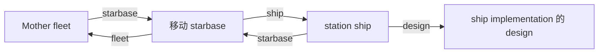

# 原生设计切换与重载绑定调查（2026-10-19）

## 目标与范围

调查 Stellaris 4.5.2 中 `set_ship_design` 的设计实例、国家登记与重载行为。只读原版、已归档原生证据及作者源码；不修改 Mod、工具、存档或验收阈值，不操作 UI。以下控制台片段最初作为供主线程审查的受控方案，后续由主线程实施的组合探针已失败，见末尾新增事实；不把方案当作已经证明的修复。

保留旧损伤比例 `1e-6` 检查失败与设计重载失败，不将两者互相替代。健康对照研究因本次设计持久化问题暂缓。

## 已观察状态与尚未证明的原因

独立原始抽取见 [rc4-m031-reload-persistence-raw-source-v1.json](evidence/1019-analysis/rc4-m031-reload-persistence-raw-source-v1.json)，其状态为 `OBSERVATION_ONLY`。主线程使用 RC4 冻结树 `06485dc540a88b30cef15c27c323ff21cd88f04ad57b79e4f5bc0590937ef468`。

- `m031sync` 的 ship1008 `ship_design_implementation.design=1592`，对应新 `NAME_EEP_Baiqi_Mothership_1019`；重载后 implementation 指向新增的 1608 旧母舰设计体。
- 新设计 1592 在重载后仍存在，全局登记仍保留旧 NAME→1493、新 NAME_1019→1592。
- 舰船实体 section 仍是 `_1019`、迁移旗标仍在、舰队六等级和国家镜像仍在；最大装甲/护盾却回到 24429.6/61776。
- 国家0 `ship_design_collection.ship_design` 在两档均不含旧母舰1493、新设计1592或重载生成1608。

这些事实说明旗标和实体 section 不能代替 implementation 指针及完整设计体检查。它们尚不能证明“未加入国家设计集合导致回退”，也不能证明某个未序列化的原始指针、舰名或重载修复函数就是原因。公开脚本资料没有描述此内部过程。

## 本机原生接口

来源目录：`C:/Users/1/AppData/Local/xenoamess_stellaries_dev/runs/20261019T130448Z/logs/script_documentation`。该运行生成的文档列出实际可用脚本 API，但没有给出完整重载算法。

| 来源 | 行号与含义 | SHA256 |
| --- | --- | --- |
| `effects.log` | 3240–3242：`create_ship_design={design=<key> ftl=<country,optional>}`，产生 `last_created_design` | `064b281a6c3a97f4261dfd30c3f761d1373a8ed82390fdc0109be9a112f6f489` |
| 同上 | 1146–1148：`add_ship_design=<target/last_created_design>`，仅 country scope，加入该国 | 同上 |
| 同上 | 2575–2580：`set_ship_design={design=<key/target/last_created_design>}`，ship/fleet scope | 同上 |
| 同上 | 1569–1571：`add_global_ship_design=<target>` 加全局设计；3352–3357 分别删除国家/全局设计 | 同上 |
| 同上 | 2644–2646：`set_auto_upgrade_components` 控制设计自动升级组件；不等于登记/持久绑定 | 同上 |
| 同上 | 3834–3840：刷新自动生成设计、重选非可设计恒星基地载荷；不是任意事件舰的通用“修正 implementation 指针”接口 | 同上 |
| 同上 | 711–717：本地事件目标支持 all scope；持久全局目标明确支持 design scope | 同上 |
| `scopes.log` | 62–64：ship→`design`；198–200：`last_created_design`→design | `32f36a3584bdead0c83e4e7ece09b417be52a438518713e06b05d36240a0f352` |
| `triggers.log` | 268–270：`is_same_value=<target>` 支持 all scope，可比较当前 design 与目标实例 | `0f3ce1d0ad7b8fcce9ca654e57632683d996e579bdbb738d2cd56d91632e534f` |
| 同上 | 3162–3164：`has_ship_owner_type` 接受 country/federation/galactic_community/global_ship_design，支持 ship/fleet/design/growth stage | 同上 |
| 同上 | 3224–3226：`has_design_flag` 支持 design；1472–1473：`has_existing_ship_design` 仅 country，条目没有给参数格式 | 同上 |

本次该原生 trigger 目录没有名为 `is_ship_design` 的条目。不猜该键或 `has_existing_ship_design` 未记载的参数。可以改用 `design={is_same_value=event_target:...}` 与真实 SAV 设计体/集合检查。effects 全表未列出任意 ship 的 `bind_design`、`recalculate_ship_design` 或同义公开 API；这只是本次目录检索边界，不能外推闭源引擎不存在内部操作。

## 原版实际用例

原版根目录：`C:/SteamLibrary/steamapps/common/Stellaris`。

| 文件 | 实际源码位置 | SHA256 |
| --- | --- | --- |
| `common/scripted_effects/grand_archive_effects.txt` | 9–17：`create_auto_updated_design_from_global_design` 先 create，再在 `last_created_design` 上启用 auto-upgrade，最后 `add_ship_design=last_created_design` | `0369d4f864e409ab4136274673fee86ff69b36ecf1ef26af3dc9513bd70c3a1a` |
| `common/scripted_effects/00_scripted_effects.txt` | 4618–4622：危机吞星者解锁执行 create→add | `9ee428c3c3ad60e9aeaeca857ab31ec1a4e7ed86537333537435f5ddd7ffb459` |
| `common/scripted_effects/biogenesis_effects.txt` | 1071–1075：新建 bioship hatchery 国家中 `NAME_Starlit_Starbase` create→add | `5a9846598a2328ce1ce2c9d5ecd973f41180dae80e741dcf2b49fd8bd9d40c76` |
| `events/biogenesis_crisis_events.txt` | 2313–2319、2354–2360：从 owner 选 behemoth_04，直接 `set_ship_design` 到 jump/cloaking 全局键 | `065fe533113472c811e1cdd569d140aa0b55dd2f7522998f2e5b7aa920fbab2c` |
| `common/global_ship_designs/000_documentation.txt` | 2–3：全局预定义设计与其他设计用途相同但手写；19–21：4.0 的 growth_stages 与旧格式兼容层；33–39：ship_owner_type/custom_design/auto_gen_design 等内部字段不应当成全局定义可随意设置的修复参数 | `8281dcde720127e2e65f3e52549fec9e2ebc6bfb8225d68165c91299a05085ae` |

对本机 `common`/`events` 的字面检索只发现上述两次原生 `set_ship_design`。没有发现同一原版调用点完整连接 create→add→set，也没有发现其前后专门保留健康或修正重载绑定的脚本范式。因此探针只组合三个分别有原生合同的操作，不能说原版已经证明这种组合一定解决本母舰问题。

## 最小受控登记探针设计（初始设计；后续结果另记）

前提：主线程已暂停，并确认现有唯一母舰属于玩家 country0。先从当前真实 SAV 确认母舰当前 implementation 是新设计；如果仍是重载后的旧体，不能把“只登记当前 design”当成新设计登记试验。不得修改原 SAV、资源、付费建造队列、C/L/R/六 tier，也不得额外调用损伤或修复效果；记录切换 API 本身造成的健康变化，保存使用新文件名。

### A：只登记当前已同步的新实例

若当前 implementation 已是新体，A 保留该实例，能单独检验登记的影响。此命令不再创建第二份设计，也不切换设计：

```text
effect event_target:eep_mothership0 = { every_owned_ship = { design = { save_event_target_as = eep_registration_probe_design } } } root = { add_ship_design = event_target:eep_registration_probe_design }
```

`save_event_target_as` 仅用于同一未中断 effect 链中的传递。第一次新保存应检查该实例是否真的出现在 country0 集合；不出现就是登记路径未成立，不能继续报告其持久性。

### B：创建国家持有实例并以目标切换

若需要从已回退状态建立独立候选，最短组合是：

```text
effect root = { create_ship_design = { design = NAME_EEP_Baiqi_Mothership_1019 } add_ship_design = last_created_design event_target:eep_mothership0 = { every_owned_ship = { set_ship_design = { design = last_created_design } } } }
```

不加 ftl override、不启用自动升级，避免改变固定载荷。B 同时引入创建和登记，因而即使成功，也只能证明这条组合路径有用，不能单独归因于 `add_ship_design`。

如需可直接诊断的持久目标，可以在 add 前加 `last_created_design={save_global_event_target_as=eep_registered_design_probe}`，之后 add/set 均用该目标。全局目标是额外受控夹具状态，不能冒充生产设计；保存后应记录并在试验分支之外避免留用。比较条件是 `design={is_same_value=event_target:eep_registered_design_probe}`，而非不存在于当前目录的 `is_ship_design`。

### 事前验收

对新 save→native reload→新 save 独立检查：

1. 同一舰船/舰队/恒星基地 ID、唯一归属与绑定；不复活或新建母舰。
2. implementation 所引用设计的完整 section/required/component 体，与实体 section、六个真实 AUX6–11 核心一致；允许引擎设计 ID 重分配，但不能变回旧体。
3. 新设计实例在国家集合的登记前后与重载后状态；全局 registry 同时检查，不能只看名字。
4. 最大三防、三防当前值/比例、六 tier/C/L/R/镜像和修正完整保留。健康预声明政策仍按原检查器报告，登记成功不豁免它。
5. 资源、付费队列/订单完全按原迁移范围核；新添加的设计实例和受控目标单独说明。
6. 任何失败保留原始 ZIP、SHA、完整原生日志和报告。一次成功仍仅该旧档/路径范围，不能宣告所有事件设计持久化已修复。

## 后续原生事实：登记不足，移动基地另存旧引用

主线程完成 create→add→set 组合。独立报告 [rc4-design-registration-probe-report-v1.json](evidence/1019-analysis/rc4-design-registration-probe-report-v1.json)，SHA256 `2f81ae837730b462e4f02911b8ebb369c2217ee822719dcf050701d415556533`，结果 FAIL（20/26检查失败）。`rdesignsync` 国家集合13→14，新增1881实际新设计，舰船822 implementation也指1881；重载后1881仍留在国家集合，舰船却改指1895旧设计。因此“只需注册到国家就能修复”已被本受控样本否定；不能重复把同一登记组合包装成新的修复。

移动恒星基地原始来源见 [rc4-mobile-starbase-design-pointer-source-v1.json](evidence/1019-analysis/rc4-mobile-starbase-design-pointer-source-v1.json)，SHA256 `4503e508573becf57bdd4a4d4a71269abd4f987ac37ac5bfd6b93c837ccf33ee`。独立抽取记录：

| 样本 | sync 舰船 implementation | sync 关联 starbase implementation | reload 两者 |
| --- | --- | --- | --- |
| public031 | ship1008→1592新 | base15→1591旧 | 1608旧 |
| paid | ship822→1866新 | base13→1865旧 | 1880旧 |
| 已登记的新实例探针 | ship822→1881新 | base13→1880旧 | 1895旧 |

这些 starbase 块另有 `level=starbase_level_juggernaut`、station 指向对应舰船、两个建造队列引用、`construction_type=starbase_shipyard`，并独立保存 `ship_design_implementation`；没有另一个 design/template/global_design 字段。尚未证明究竟哪个重载流程决定恢复方向，但这是一项可直接核验的 ship/base 引用差异，不能只检查 ship 部分。

### 移动恒星基地原生接口范围

- `scopes.log:266–268` 的 `starbase` 可从 ship/fleet 到关联基地；94–96 的 `ship` 可从基地回 station ship。经此返回同一 ship 再调用 ship effect，不等于新增了更新基地独立引用的接口。
- `effects.log:2575–2580` 的 `set_ship_design` 只列 ship/fleet，不列 starbase。不可把效果直接放在 starbase scope 当作受支持的修复。
- `effects.log:1850–1852` 的 `set_starbase_size=<ship_size>` 只声明改尺寸，没有 design 参数，也没有队列保持承诺。原版 `events/astral_planes_events.txt:2688–2693` 是 outpost→starport 后设置船坞的场景，不是 Juggernaut 同尺寸保付费队列换固定载荷的例子。
- `create_starbase:1839–1848` 的确可传 design，但它创建基地，不能用新建/替换实体冒充现存基地迁移。
- `rebuild_owned_starbase_designs:3838–3840` 是 country 范围重选非可设计基地的自动载荷，不能指定本母舰固定设计，文档也没承诺保留付费队列。`refresh_auto_generated_ship_designs` 同样不提供目标 design 参数。
- 本次 effects 目录没有 `set_starbase_design`、`set_starbase_template` 或直接写 `ship_design_implementation` 的公开效果。这里只报告该版本目录，不声称闭源引擎没有内部入口。
- 原生 `common/ship_sizes/18_juggernauts.txt:10` 是十船坞，52–53是 starbase class / shipyard construction；其 SHA256 `3402b13978de2bbcc36c6d4eedab9e4a9ac7f5160183fa2b908029f10842f11f`。`common/starbase_levels/01_juggernauts.txt:1–5` 仅把 level 对应到 juggernaut size，没有设计模板字段，SHA256 `13aa6b5590fcd479dc87fef2eabea3d691cab0f17affde2b1e512f0f9fe0883d`。
- `common/ship_sizes/00_ship_sizes.txt:101–102` 注释区分国家自动生成设计的自动升级与非可设计基地逐实例设计，SHA256 `5d8fb948b2197e8a39e021a8501574e043d3c1fd3db7e0c8b9b0b1142da65c2f`。这解释了需要分开检查设计对象，但不能从该注释推导本母舰属于哪个未实测内部分支。

主线程下一项受控候选仅切换已有 API 的 fleet scope：

```text
effect event_target:eep_mothership0 = { set_ship_design = { design = NAME_EEP_Baiqi_Mothership_1019 } }
```

它与逐 ship 调用的实际差别在设计时未知。主线程现已完成 `rfleetsync`：ship implementation1866新、base implementation1909旧，仍不同；独立报告 [rc4-fleet-scope-design-probe-report-v1.json](evidence/1019-analysis/rc4-fleet-scope-design-probe-report-v1.json)，SHA256 `a82b0df361d464f37e5f6df3f72f999acab2874d9c00b319d443cf977da36532`，FAIL（13/15检查失败）。原生 ZIP `rfleetsync.sav` SHA256 `df1c501844f00823b979c0a064251fa091cab4716cbc0205034ae3cccb1e28c6`。这项输入没有更新关联基地引用，不能当作持久修复；无需再为相同前提额外重载。

### 名称键调查与判据边界

`set_name` 本次自动生成 effects 468–470 明确支持 ship/fleet，参数是字符串或目标。原版 `events/distant_stars_events_1.txt:1554–1556` 给 lost amoeba ship 设置 `NAME_Bubbles`，该文件 SHA256 `7882409404f07566b2fbf8af1613da27318b7d98d8863a740492b9e2e18081c6`。原版 `events/paragon_events_3.txt:485–486` 给 last talon ship 设置 `NAME_LastTalon`，1431–1435甚至为相同船只分别指定船名 `NAME_LastTalon` 与设计 `NAME_FirstClaw`，文件 SHA256 `a1b6d030d3dbc4582b9412b86492d8c1f64d1b0b8799ee73e3c15dd3d247d4c8`。它们证明船名可使用本地化键，而且事件舰船名可以与设计名不同；不能由此推导 Mother 重载不受名称影响或一定受其影响。

原生全局设计文档13–14行只说明 `use_design_name` 决定采用设计名还是生成船名、`is_event_design` 表示事件用途；没有承诺 `ship.name` 是重载查找设计的索引。原生 trigger 目录没有 `has_name`/`is_name`；字面检索本机171个 events TXT、2063个 common TXT 亦没有 `has_name`。因此本次不能给出该 trigger 比较本地化键、显示文本或自定义名的语义，更不能把它写为生产迁移条件。

主线程名称键 probe 仍在采样时，本研究不预写成功或失败结论。验收仍以两份 implementation、完整设计体、实体载荷、当前值/最大值、付费队列和重载原始证据为准。

## 全局设计初始化与同尺寸基地更新候选（只读准备）

### `add_global_ship_design` 的完整公开合同

当前生成的 effects1569–1571仅有三行：描述是把特定全局设计加入游戏，语法 `add_global_ship_design=<target>`，scope为all。没有 `replace`、`overwrite`、`update_existing`、`preserve_queue` 或指定现存 starbase 的参数，也没承诺同名已存在时重新导入文件。

原版实际把定义名字符串传入该效果，补足了仅写 `<target>` 的文档歧义：

| 原版文件 | 实际位置/用途 | SHA256 |
| --- | --- | --- |
| `common/fallen_empires/00_fallen_empire.txt` | 55–66，创建没落帝国时在“must initialize global designs here”之后初始化 `NAME_Enforcer` 等舰船与基地全局设计 | `f9cd00b27bd9aa686af22e9c84a17f3d2645cf8261ab222a26a2bb6fdddb232e` |
| `common/scripted_effects/02_machine_age_effects.txt` | 2294–2304等，飞升为没落帝国时按类型加入 `NAME_Omega` 等设计 | `fb5d57a18af03d2794a0a26bbf6b5655f00db9263bcc41b145327768c64d4db1` |
| `common/scripted_effects/fallen_empire_scripted_effects.txt` | 1911–1926等，初始化蜂巢没落帝国设计 | `0ec831cf8f458e17c183cbc2a367b2dd8d3d90b4bb0b1733a91590a61c29b911` |
| `common/solar_system_initializers/federations_initializers.txt` | 1362–1370等，初始化失落殖民/没落帝国相关设计 | `16b8cf994c5b46b8e08a56f2741f93cffd0b2979702d9a1e53914ae9c5356bfd` |

原版 common/events 字面赋值共187处、分布四个文件；没有 `remove_global_ship_design` 赋值。检索所见是初始化模式，没有为已存在的移动基地改写独立 implementation 的源码范式。不能由“adds global design”推导会替换 base 内旧设计引用。

本机 Workshop `2660548454`（Age of Wonder，descriptor标v4.4.*）的 `events/AOW_evts_notification.txt:1301` 也有按键 add_global，但紧接1302–1306删除该类基地的 station ship，不是保实体/付费队列迁移方案，故不复用。文件 SHA256 `cccc9c03959b21a599e0fa387111bfede8ecbf3c79cc6e53c604c6ca0ab45bb7`，descriptor SHA256 `0161128182577889de7758f505e59e56d4df1dbeebde6a1ec931679d7b174f5e`。此处仅作者源码观察，不把4.4包声称为4.5.2已验。

### 同尺寸 `set_starbase_size` 的原始来源边界

`effects1850–1852` 及原版 `common/starbase_modules/00_example.txt:549–550` 都只说改变 level/ship_size。后者 SHA256 `c290af5f9f2d785803cb3ad843573e3fc31822f937382d8730948cdc7ad3282e`。

实际移动基地链路见 `02_machine_age_effects.txt:2463–2486`：选择首都 arkship fleet→`starbase`→按 civilian/science/military 类型设置对应 tier3 size。该筛选未排除已是tier3的输入，说明原版脚本允许这类调用入口，但没有原文说明同尺寸会强制重算，也不能从脚本静态条件认定该分支实际遇到过tier3。

本机原版 common/events 共44处 `set_starbase_size` 字面赋值（包含上述文档注释一处），没有 `set_starbase_size=juggernaut`；已安装 Workshop 的 TXT 亦未找到该精确 juggernaut 赋值。网络精确查询同样未取得原始作者成功例。故“同 juggernaut 尺寸可刷新设计”仍是待测假设，非原版已证能力。

### 移动基地 scope 与组件/设计边界



上述链分别由 scopes58–64、94–96、266–268支持，fleet→starbase还有前述原版 arkship 用例。当前目录没有 starbase→自身 design 的 scope，也没有 component scope；`starbase.ship.design` 回到 station ship 引用，不能作为基地内部引用的替代观察。

原版 module文档7–10行明确模块若改变 section会重建设计，24行起 equipped_component/triggered_equipped_component支持实际装备；但该流程要安装/替换模块，不能静态保证 Mother 的固定船段与付费队列不受影响。`add_starbase_component` 是另一路 standalone接口，此前 Mother 原生探针已证明列表可存而属性未生效，不能把它再当作修复 implementation 的已证入口。

### 两个最短、分开的受控候选

这两项只作为主线程可选择的独立夹具试验，不进入生产代码，不混合执行后再猜哪项生效。前提是唯一归属正确的 Mother 已经新ship/旧base，事先保存并记录两份设计、两队列完整内容及资源；原档原字节保留。两命令都没有脚本层的队列保持保证。

先以原版已用的全局键形式单独初始化：

```text
effect root = { add_global_ship_design = NAME_EEP_Baiqi_Mothership_1019 }
```

本案 registry 原本已存在该新键，预期不能先假设会改变它。只保存检查 registry与ship/base引用；若仍不同，记录该次输入未修正，不增加重载步骤。不要删除仍有舰船/队列引用的旧全局设计来制造通过。

若主线程决定检验同尺寸路径，使用确切支持的 fleet→starbase scope：

```text
effect event_target:eep_mothership0 = { starbase = { set_starbase_size = juggernaut } }
```

该效果只能接收 ship_size，不能添猜测的 design 或 preserve_queue 参数。先新保存核是否无作用、是否重选自动载荷、或是否双引用一致；任何错误设计、实体变化或队列变动都保留失败，不能归为成功刷新。只有两份引用均指向完整新固定设计、实体与六核心一致、健康/资源/队列满足原政策，才值得追加 native reload 检验持久性。当前文档没有为此预写通过结果。

## 互联网检索边界

已检索 `Stellaris "set_ship_design" "save"`、`"set_ship_design" "add_ship_design"`、官方论坛与 GitHub 的精确 API 查询。公开搜索主要返回文档转录及版本日志，没有取得能解释本母舰回退的官方底层实现；不使用非原始转载建立技术结论。

### 作者源码：显式登记惯例

以下是作者仓库固定 commit `436812fb3acd9dc7d6cb5e666268a3a1d8135aa7` 的实际代码，版本描述为 Giga 3.40.4 DEV / Stellaris v4.5.*。并行只读调查从 raw 文件逐行与 SHA 核对，没有下载整个仓库。

- [giga_aeternum_scripted_effects.txt](https://github.com/Pouchkinn-s-Gigastructures/Gigastructures/blob/436812fb3acd9dc7d6cb5e666268a3a1d8135aa7/common/scripted_effects/giga_aeternum_scripted_effects.txt#L153)：153–154 与175–176 两个分支分别创建 Suojelija 设计，再 `add_ship_design=last_created_design`。SHA256 `7660135d2f3617942b32904fbee8744184bd6495330d70dced49cc58c5ee3eaa`。
- [giga_191_compound_spawn.txt](https://github.com/Pouchkinn-s-Gigastructures/Gigastructures/blob/436812fb3acd9dc7d6cb5e666268a3a1d8135aa7/events/giga_191_compound_spawn.txt#L121)：121–124 的四个设计逐一 create→add。SHA256 `b077ee92cbaeecbcb5f6a8ea24388b9dc7039c5dd53cf93205eb228cb961b70c`。

界限：上述只有国家登记，没有现有舰船 `set_ship_design` 或重载保证。对该 commit 的有界检索读取52个 TXT，其中44/47个 `common/scripted_effects`、8个 events；未命中 `set_ship_design`。未读三个大 scripted_effects（`ehof_mega.txt`、`giga_corrona_effects.txt`、`giga_menu_effects.txt`），events 也未全扫。因此只能说已读集合未找到，不声称全仓库不存在。

为核 fleet scope 正例，另完整字面检索本机22个已安装 Workshop 目录的 TXT，未命中 `set_ship_design`；公开精确 `fleet`/`random_owned_fleet`/`every_owned_fleet` 查询也未获得作者源码调用点，只返回文档转录。fleet 候选目前的依据就是本机原生生成目录明确支持 fleet，不伪称已获成熟 Mod 的重载验收经验。

### 官方历史：专属设计持久化修复

[Stellaris 4.3 Cetus Open Beta Updated (2026-01-15)](https://steamstore-a.akamaihd.net/news/externalpost/steam_community_announcements/1821922921813186) 的官方原文记录：“Changing the design of Deep Space Citadels now works correctly, persisting in save games.”

使用 [Steam News API](https://api.steampowered.com/ISteamNews/GetNewsForApp/v0002/?appid=281990&count=20&maxlength=0&enddate=1768608000) 核原文：gid `1821922921813186`，作者 `PDX_ladydzra`，Unix date `1768486742`，整份响应212852bytes、SHA256 `9609953e14d2c7eecaa1029eb79a787330c8d1f1350ef7ca2438422657bd74a0`。这仅证明设计持久化存在过针对 Deep Space Citadel 的专门修复；发布说明没有脚本替代方案，不能据此断定 Mother 的原因、接口内存实现或4.5.2同类错误。

### 本轮日志补充（读取时观察）

读取运行 `20261019T133314Z/logs/error.log` 时为7665bytes、SHA256 `33375065d206e53465609461b4be8f98b5bc556422efbc9b32bb1fc9e409a23f`。23–39行记录两次调用 `eep_sync_mothership` 时部分国家/舰队变量未设置的 `variable_values.cpp` 信息；所查日志没有 `set_ship_design`、1592、1608专属错误命中。该文件仍属于运行中的可变日志，以上是读取时状态，不冒充不可变归档，不归因这些变量信息导致设计回退，也不据此宣称调用无错误。
